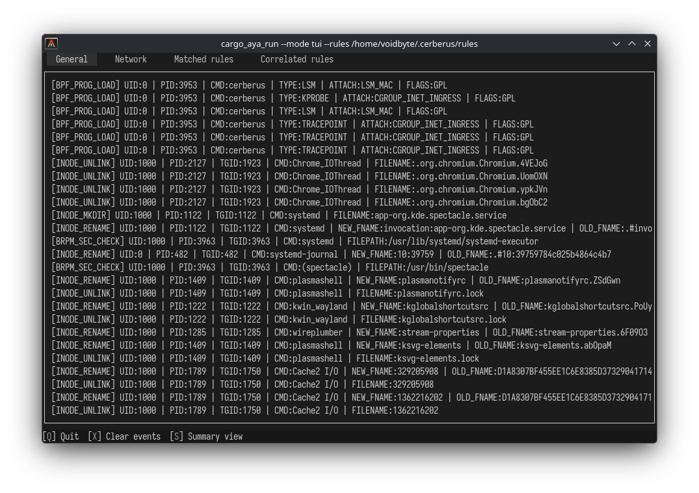
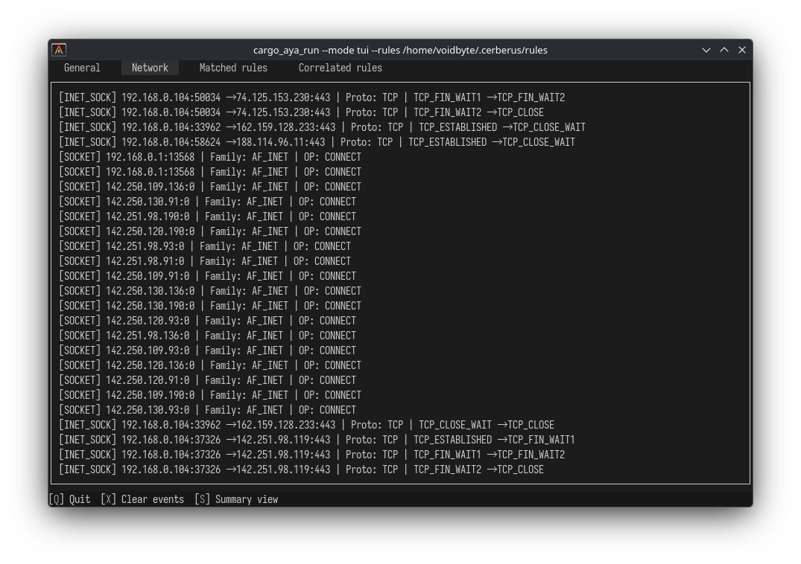
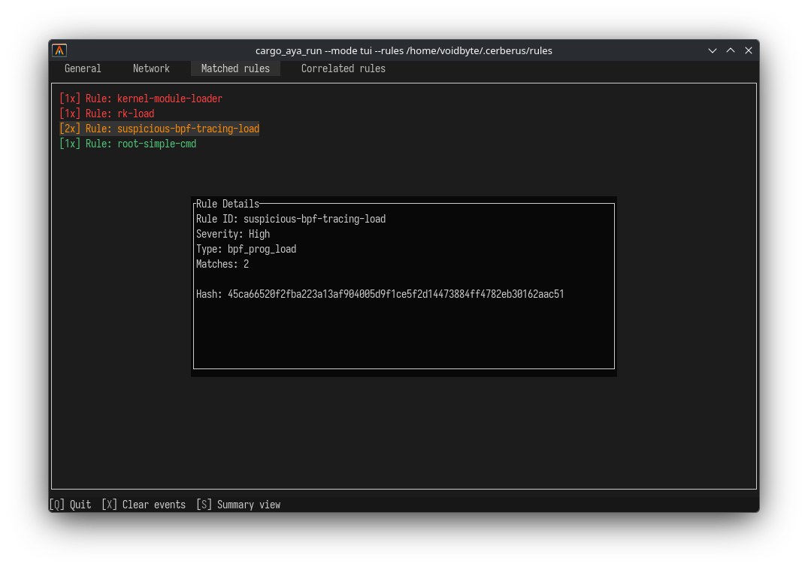
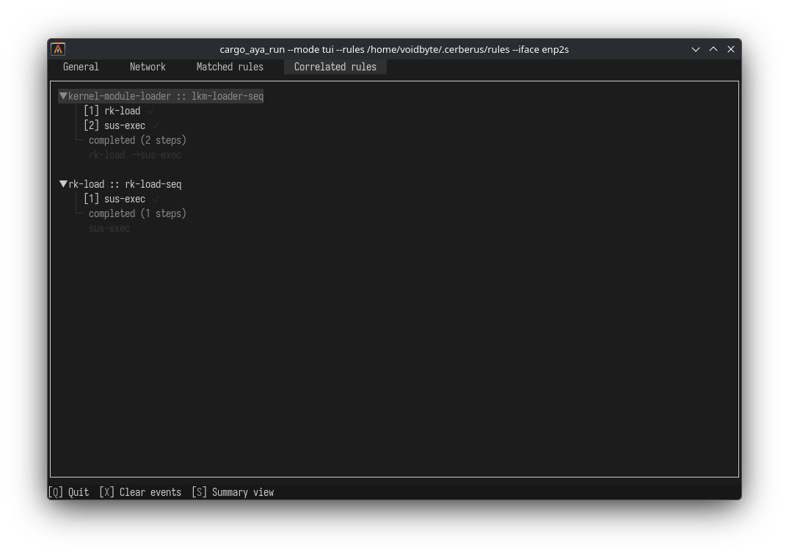
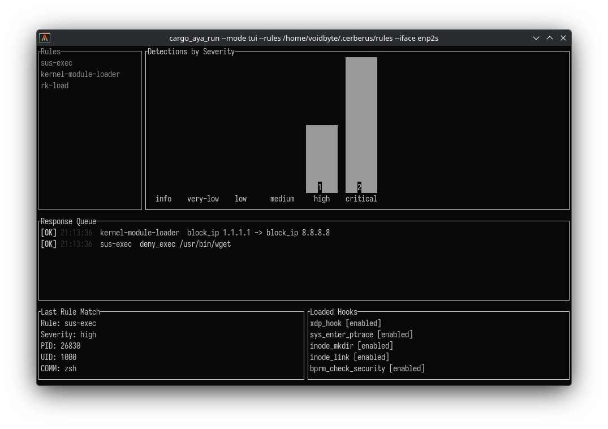

# Cerberus







## Prerequisites

1. stable rust toolchains: `rustup toolchain install stable`
1. nightly rust toolchains: `rustup toolchain install nightly --component rust-src`
1. (if cross-compiling) rustup target: `rustup target add ${ARCH}-unknown-linux-musl`
1. (if cross-compiling) LLVM: (e.g.) `brew install llvm` (on macOS)
1. (if cross-compiling) C toolchain: (e.g.) [`brew install filosottile/musl-cross/musl-cross`](https://github.com/FiloSottile/homebrew-musl-cross) (on macOS)
1. bpf-linker: `cargo install bpf-linker` (`--no-default-features` on macOS)
1. Linux kernel with eBPF and LSM support:
   - Kernel 5.7+ (5.10+ recommended)
   - `CONFIG_BPF_LSM=y` enabled
   - `bpf` listed in the active LSMs (`cat /sys/kernel/security/lsm`)

   If `bpf` is not present in the output, you may need to enable it by adding
   `bpf` to the kernel boot parameters, for example:

   ```sh
   # Edit /etc/default/grub and append ',bpf' to the LSM list
   GRUB_CMDLINE_LINUX="... lsm=lockdown,yama,integrity,apparmor,bpf"
   sudo grub-mkconfig -o /boot/grub/grub.cfg
   # Reboot
   ```

1. libbpf-devel (Package manager)

## Build & Run

Build the project as usual:

```sh
cargo build
cargo check
```

By default, Cerberus looks for detection rules in:

```text
~/.cerberus/rules
```

You can use a custom rules directory with `--rules`.

Run Cerberus with:

```sh
cargo run -p cerberus --release \
  --config 'target."cfg(all())".runner="sudo -E"' -- \
  --iface <interface> \
  [OPTIONS]
```

### Common options

| Option                 | Description                                                                                         |
| ---------------------- | --------------------------------------------------------------------------------------------------- |
| `--mode <tui\|agent>`  | Run mode (default: `tui`)                                                                           |
| `--rules <DIR>`        | Directory containing detection rules (default: `~/.cerberus/rules`)                                 |
| `--log <PATH>`         | Write logs to a file or directory                                                                   |
| `--container-resolver` | **Experimental (currently unavailable)**. Enable Docker/Kubernetes container metadata resolution    |
| `--watchdog`           | Enable the orthrus watchdog (requires the orthrus kernel module - see [Orthrus](#orthrus-watchdog)) |

### TUI mode

Using the default rules directory:

```sh
cargo run -p cerberus --release \
  --config 'target."cfg(all())".runner="sudo -E"' -- \
  --mode tui \
  --iface eth0
```

Using a custom rules directory:

```sh
cargo run -p cerberus --release \
  --config 'target."cfg(all())".runner="sudo -E"' -- \
  --mode tui \
  --rules path/to/rules \
  --iface eth0
```

With logging:

```sh
cargo run -p cerberus --release \
  --config 'target."cfg(all())".runner="sudo -E"' -- \
  --mode tui \
  --iface eth0 \
  --log ./logs
```

### Agent mode

Run continuously:

```sh
cargo run -p cerberus --release \
  --config 'target."cfg(all())".runner="sudo -E"' -- \
  --mode agent \
  --iface eth0
```

Using a custom rules directory:

```sh
cargo run -p cerberus --release \
  --config 'target."cfg(all())".runner="sudo -E"' -- \
  --mode agent \
  --rules path/to/rules \
  --iface eth0
```

Run for a fixed duration:

```sh
cargo run -p cerberus --release \
  --config 'target."cfg(all())".runner="sudo -E"' -- \
  --mode agent \
  --iface eth0 \
  --time 2m
```

With logging:

```sh
cargo run -p cerberus --release \
  --config 'target."cfg(all())".runner="sudo -E"' -- \
  --mode agent \
  --iface eth0 \
  --time 2m \
  --log ./logs
```

Cargo build scripts automatically build the eBPF program and bundle it with the userspace binary.

## Orthrus watchdog

An eBPF security agent has a structural blind spot: it cannot reliably observe
attacks against itself. If its programs are detached, its process is killed, or
its components are removed, it goes silent - and the silence is invisible,
because the sensor that would report the tampering is the thing being disabled.

**Orthrus** is a companion Linux kernel module that watches Cerberus from a
vantage point Cerberus cannot occupy. It detects:

- **the agent going silent** - Cerberus sends a periodic heartbeat; if it stops,
  orthrus raises a stale-heartbeat tamper;
- **eBPF programs being dropped** - each heartbeat reports the agent's attached
  program count; a drop below the established healthy level is flagged, and a
  drop to zero while the agent is still alive (the "alive but blind" state) is
  raised as critical;
- **the watchdog itself being removed** - unloading the module fires a tamper on
  the way out, so removing the watchdog is noisy rather than silent.

Tamper events cross into userspace over generic netlink and enter Cerberus's
rule engine as ordinary events, so they are matched by the same rule language as
everything else. "The monitor was attacked" becomes a rule-matchable detection.

> **Security note.** Orthrus catches accidental failure and unsophisticated
> tampering, and makes deliberate blinding noisy. The reported program count is
> agent-supplied, so a fully compromised agent can lie; and a kernel module
> cannot defeat an adversary with full kernel control. Orthrus raises the cost
> and visibility of disabling the monitor - it is not an absolute defense.

### Building and loading the module

The module lives under `watchdog/`. Build it against your running kernel:

```sh
cd watchdog
make          # use `make LLVM=1` if your kernel was built with clang
```

Load it (kernel code - load only on a system you can recover):

```sh
sudo insmod build/orthrus.ko
dmesg | tail    # should show: family 'orthrus' registered, watchdog armed
```

Unload it with `sudo rmmod orthrus`. For persistence across reboots and kernel
updates, install via the provided DKMS config.

### Running Cerberus with the watchdog

With the module loaded, pass `--watchdog`:

```sh
cargo run -p cerberus --release \
  --config 'target."cfg(all())".runner="sudo -E"' -- \
  --mode agent \
  --iface eth0 \
  --watchdog
```

Cerberus will begin heartbeating to orthrus and listening for tamper events. Add
rules that match on `orthrus.tamper.kind` (or `.severity`) to act on them - see
the field reference for the tamper fields and their values.

## Cross-compiling on macOS

Cross compilation should work on both Intel and Apple Silicon Macs.

```shell
CC=${ARCH}-linux-musl-gcc cargo build --package cerberus --release \
  --target=${ARCH}-unknown-linux-musl \
  --config=target.${ARCH}-unknown-linux-musl.linker=\"${ARCH}-linux-musl-gcc\"
```

The cross-compiled program `target/${ARCH}-unknown-linux-musl/release/cerberus` can be
copied to a Linux server or VM and run there.

If tracefs is not mounted automatically, it must be done manually with:

```shell
sudo mount -t tracefs tracefs /sys/kernel/tracing
```

## Development

### Prerequisites

1. All prerequisites from the top of the readme
1. bindgen-cli
1. aya-tool (for generating vmlinux)

```shell
cargo install bindgen-cli
cargo install --git https://github.com/aya-rs/aya -- aya-tool
```

## License

With the exception of eBPF code, Cerberus is distributed under the terms
of either the [MIT license] or the [Apache License] (version 2.0), at your
option.

Unless you explicitly state otherwise, any contribution intentionally submitted
for inclusion in this crate by you, as defined in the Apache-2.0 license, shall
be dual licensed as above, without any additional terms or conditions.

### eBPF

All eBPF code is distributed under either the terms of the
[GNU General Public License, Version 2] or the [MIT license], at your
option.

Unless you explicitly state otherwise, any contribution intentionally submitted
for inclusion in this project by you, as defined in the GPL-2 license, shall be
dual licensed as above, without any additional terms or conditions.

[Apache license]: LICENSE-APACHE
[MIT license]: LICENSE-MIT
[GNU General Public License, Version 2]: LICENSE-GPL2
